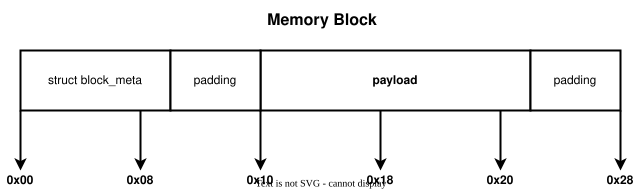
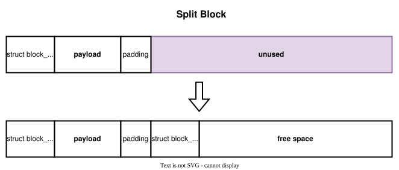
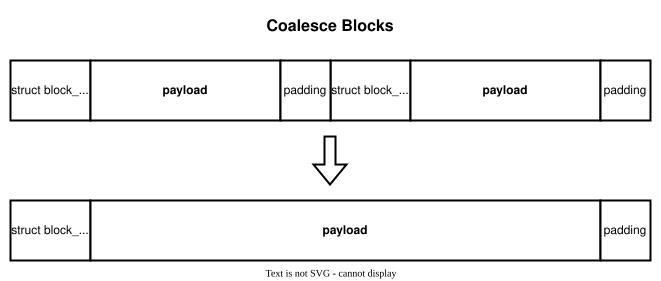

# Memory Allocator

A minimal `malloc()` / `calloc()` / `realloc()` / `free()` implementation for Linux, written in C on top of the `brk()` and `mmap()` system calls. It builds as a shared library (`libosmem.so`) and is verified by a syscall-level test suite.

## Features

- **Hybrid allocation**: small requests are served from the heap (`brk`/`sbrk`); requests of `MMAP_THRESHOLD` (128 KiB) or more get their own `mmap()` region and are released with `munmap()`.
- **Heap preallocation**: the first heap allocation reserves 128 KiB once, so later small requests need no extra syscalls.
- **Block reuse**: freed blocks are marked free and reused instead of being returned to the OS.
- **Block splitting**: an oversized free block is split, and the remainder becomes a new free block.
- **Block coalescing**: adjacent free blocks are merged to reduce external fragmentation.
- **Best-fit search** over the block list.
- **8-byte alignment** for metadata and payloads.

## How it works

Every block starts with a `struct block_meta` header (see [`utils/block_meta.h`](utils/block_meta.h)) followed by the payload. Callers only ever see the payload address.

```c
struct block_meta {
	size_t size;               // payload size in bytes
	int status;                // STATUS_FREE | STATUS_ALLOC | STATUS_MAPPED
	struct block_meta *prev;
	struct block_meta *next;
};
```



| Operation | Behaviour |
|-----------|-----------|
| `os_malloc(size)` | Returns `NULL` for `0`. Heap block if below the threshold, otherwise `mmap`. Memory is uninitialized. |
| `os_calloc(n, size)` | Like `os_malloc(n * size)`, but zeroed. Uses `page_size` as the heap/`mmap` threshold. |
| `os_realloc(ptr, size)` | `NULL` ptr acts as `malloc`; size `0` acts as `free`. Tries to expand in place (coalescing following free blocks) before moving. Returns `NULL` on a freed block. |
| `os_free(ptr)` | Heap blocks are marked free and coalesced; mapped blocks are `munmap`ed. |

Splitting and coalescing:




## Project layout

```
.
├── src/     Allocator implementation (osmem.c) and its Makefile
├── utils/   Public API (osmem.h), block metadata, heap-free printf()
├── tests/   Test snippets, reference syscall traces, test runner
└── docs/    Diagrams used in this README
```

## Build

```console
$ cd src && make
```

This produces `src/libosmem.so`. Link a program against it with `-L src -losmem -I utils`.

## Test

The test runner executes each snippet under `ltrace` and compares the `os_*` calls and the syscalls they make against a reference trace in `tests/ref/`.

```console
$ cd tests
$ make check        # build everything, run all tests (with leak checks)
$ make check-fast   # same, without leak checks
$ python3 run_tests.py test-malloc-coalesce   # a single test
```

Requirements: `gcc`, `make`, `python3`, `ltrace`, and `valgrind` (for leak checks).
Run `make lint` in `tests/` for a style check with [`cpplint`](https://github.com/cpplint/cpplint).

## Status

`os_malloc`, `os_calloc` and `os_free` are implemented in [`src/osmem.c`](src/osmem.c). `os_realloc` currently handles only the `NULL` pointer and zero-size cases and still needs the resize/expand logic.

## Constraints

- `mremap()` is not used.
- Every syscall's return value is checked.
- Only Linux x86-64 is targeted.

## Resources

- [Implementing malloc (Michael Saelee)](https://moss.cs.iit.edu/cs351/slides/slides-malloc.pdf)
- [Malloc Tutorial (Dan Luu)](https://danluu.com/malloc-tutorial/)
